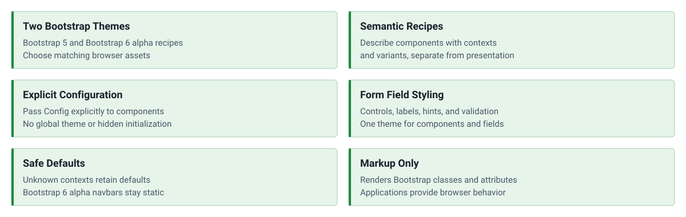

<!-- markdownlint-disable MD041 -->
<p align="center">
    <a href="https://github.com/ui-awesome/html-theme-bootstrap" target="_blank">
        
    </a>
    <h1 align="center">Html Theme Bootstrap</h1>
    <br>
</p>
<!-- markdownlint-enable MD041 -->

<p align="center">
    <a href="https://github.com/ui-awesome/html-theme-bootstrap/actions/workflows/build.yml" target="_blank">
        
    </a>
    <a href="https://dashboard.stryker-mutator.io/reports/github.com/ui-awesome/html-theme-bootstrap/main" target="_blank">
        
    </a>
    <a href="https://github.com/ui-awesome/html-theme-bootstrap/actions/workflows/static.yml" target="_blank">
        
    </a>
    <a href="https://github.com/ui-awesome/html-theme-bootstrap/actions/workflows/security.yml" target="_blank">
        
    </a>
</p>

<p align="center">
    <strong>Bootstrap themes for the UI Awesome component ecosystem.</strong><br>
    <em>Application-scoped recipes for Bootstrap 5.3 and Bootstrap 6.0.0-alpha.1.</em>
</p>

## Features

<picture>
    <source media="(max-width: 767px)" srcset="./docs/svgs/features-mobile.svg">
    
</picture>

### Installation

```bash
composer require ui-awesome/html-theme-bootstrap:^0.1
```

Requires PHP 8.3 or later. The `0.1` line is under development, and the runtime dependencies `ui-awesome/html`,
`ui-awesome/html-core`, `ui-awesome/html-core-component`, `ui-awesome/html-field`, and `ui-awesome/html-svg` are
required at development stability (`@dev`). Composer honours stability flags only from the root package, so the
application's `composer.json` must allow development versions:

```json
{
  "minimum-stability": "dev",
  "prefer-stable": true
}
```

### Quick start

A theme resolves configuration recipes for semantic component contexts. Pass it to components through an
application-scoped `Config`, and describe each component with a `ComponentContext`.

#### Bootstrap 5

```php
use UIAwesome\Html\Core\Component\Alert;
use UIAwesome\Html\Core\Config\{ComponentContext, Config};
use UIAwesome\Html\Theme\Bootstrap\Bootstrap5Theme;

$config = new Config(theme: new Bootstrap5Theme());

echo Alert::tag()
    ->config($config, new ComponentContext('alert', variant: 'success'))
    ->content('Your changes have been saved.')
    ->id('alert-saved')
    ->render();
```

Output:

```text
<div class="alert alert-success" id="alert-saved" role="alert">
Your changes have been saved.
</div>
```

States refine a variant. The `dismissible` state adds the Bootstrap close button:

```php
echo Alert::tag()
    ->config($config, new ComponentContext('alert', variant: 'danger', states: ['dismissible']))
    ->content('Your session expired.')
    ->id('alert-session')
    ->render();
```

Output:

```text
<div class="alert alert-danger alert-dismissible fade show" id="alert-session" role="alert">
Your session expired.
<button class="btn-close" type="button" aria-label="Close" data-bs-dismiss="alert">
</button>
</div>
```

#### Bootstrap 6 alpha

`Bootstrap6Theme` targets Bootstrap **6.0.0-alpha.1**. Support is experimental and tied to that alpha, not to a stable
Bootstrap 6 release.

The `navbar` context renders a Bootstrap 6 navigation bar. The menu marks the item that matches the current path as
active and styles disabled items.

```php
use UIAwesome\Html\Core\Component\{Item, Menu, NavBar};
use UIAwesome\Html\Theme\Bootstrap\Bootstrap6Theme;

$config = new Config(theme: new Bootstrap6Theme());

echo NavBar::tag()
    ->config($config, new ComponentContext('navbar'))
    ->brandLink('/')
    ->brandText('UI Awesome')
    ->menu(
        Menu::tag()
            ->currentPath('/docs')
            ->id('main-menu')
            ->items(
                Item::tag()->label('Home')->link('/'),
                Item::tag()->label('Docs')->link('/docs'),
                Item::tag()->label('Pricing')->link('/pricing'),
                Item::tag()->label('Enterprise')->link('/enterprise')->disabled(),
            ),
    )
    ->render();
```

Output:

```text
<nav class="navbar navbar-expand bg-1">
<div class="container-fluid">
<a class="navbar-brand" href="/">
UI Awesome
</a>
<div class="flex-grow-1" id="main-menu">
<ul class="nav navbar-nav">
<li class="nav-item">
<a class="nav-link" href="/">
Home
</a>
</li>
<li class="nav-item">
<a class="nav-link active" href="/docs" aria-current="page">
Docs
</a>
</li>
<li class="nav-item">
<a class="nav-link" href="/pricing">
Pricing
</a>
</li>
<li class="nav-item">
<a class="nav-link disabled" href="/enterprise">
Enterprise
</a>
</li>
</ul>
</div>
</div>
</nav>
```

#### Form fields

`ui-awesome/html-field` uses the same configuration to theme the field and its control, label, hint, and validation
feedback. `$form` is any `UIAwesome\FormModel\FormModelInterface` implementation.

```php
use UIAwesome\Html\Field\Field;

echo Field::tag()
    ->config($config)
    ->formModel($form)
    ->property('email')
    ->control('email')
    ->render();
```

#### Theme selector

The `selector-theme` toggle renders a button with a moon icon (`theme-dark-icon`) and a sun icon (`theme-light-icon`),
both hidden with `d-none`. The package ships no JavaScript, so the application switches the color mode.

```php
use UIAwesome\Html\Core\Component\Toggle;

echo Toggle::tag()
    ->config($config, new ComponentContext('toggle', variant: 'selector-theme'))
    ->id('theme-selector')
    ->render();
```

Bootstrap 5.3 and Bootstrap 6 alpha both read the color mode from the `data-bs-theme` attribute. This example script
toggles it on `<html>`, shows the icon for the mode the button switches to, and stores the choice in `localStorage`.
Load it after the button, and adapt it to the application's asset pipeline.

```js
const root = document.documentElement;
const icons = {
  dark: document.getElementById("theme-dark-icon"),
  light: document.getElementById("theme-light-icon"),
};

const apply = (theme) => {
  root.setAttribute("data-bs-theme", theme);
  icons.dark.classList.toggle("d-none", theme === "dark");
  icons.light.classList.toggle("d-none", theme === "light");
};

const preferred = matchMedia("(prefers-color-scheme: dark)").matches
  ? "dark"
  : "light";

apply(localStorage.getItem("theme") ?? preferred);

document.getElementById("theme-selector").addEventListener("click", () => {
  const theme =
    root.getAttribute("data-bs-theme") === "dark" ? "light" : "dark";

  localStorage.setItem("theme", theme);
  apply(theme);
});
```

#### Supported contexts

Both themes resolve recipes for the `alert`, `breadcrumb`, `dropdown`, `navbar`, and `toggle` components and for the
`field` slots (label, controls, choice containers and labels, hints, and errors). Supported variants differ by
Bootstrap version: for example, Bootstrap 6 adds the `accent` and `inverse` alert variants and a neutral alert without
a variant, and has no `light` or `dark` alert variants. A context the theme does not recognize yields no recipe, so the
component keeps its own defaults.

#### Assets and compatibility

- Load the matching Bootstrap CSS and JavaScript separately in your application. This package renders markup and does
  not install, load, or initialize browser assets.
- Bootstrap 6 alpha uses ES modules; do not assume a `window.bootstrap` global or reuse Bootstrap 5 initialization.
- Bootstrap 6 navigation is **static only**. The core component model does not yet provide the dialog/drawer structure
  required for responsive Bootstrap 6 navigation; `toggle.menu` has no Bootstrap 6 recipe.
- The theme selector styles a control only. Switching color schemes and persisting the selection require application
  JavaScript; see [Theme selector](#theme-selector).

## Documentation

For detailed configuration options and advanced usage.

- 🧪 [Testing Guide](docs/testing.md)

## Package information

[](https://www.php.net/releases/8.3/en.php)
[](https://packagist.org/packages/ui-awesome/html-theme-bootstrap)
[](https://packagist.org/packages/ui-awesome/html-theme-bootstrap)

## Project status

[](https://codecov.io/github/ui-awesome/html-theme-bootstrap)
[](https://github.com/ui-awesome/html-theme-bootstrap/actions/workflows/static.yml)
[](https://github.com/ui-awesome/html-theme-bootstrap/actions/workflows/quality.yml)
[](https://github.styleci.io/repos/777837641?branch=main)

## Our social networks

[](https://x.com/Terabytesoftw)
[](https://www.facebook.com/wilmer.arambula.9)

## License

[](LICENSE)
